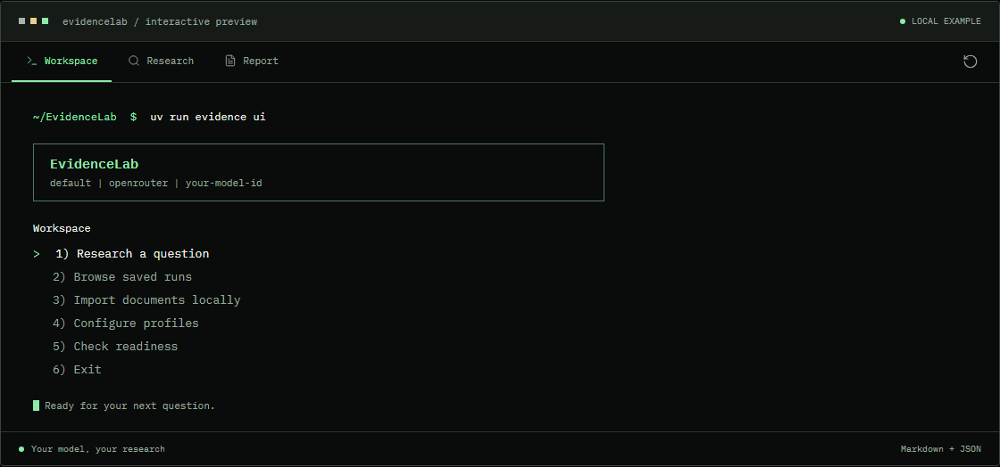
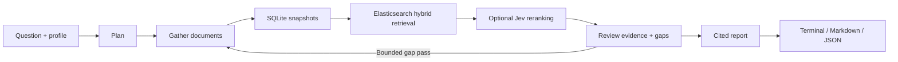

# EvidenceLab

EvidenceLab plans a research question, collects documents, retrieves relevant passages with Elasticsearch, reviews gaps, and saves a cited report. Use the interactive workspace or ordinary commands. Jev reranking is optional.

[Landing page](https://lord-rheagar.github.io/EvidenceLab/) · [Getting started](#quick-start) · [Command reference](#commands) · [Detailed guide](docs/reference.md)





## What You Can Do

- Choose OpenAI, Anthropic, Gemini, OpenRouter, or an OpenAI-compatible endpoint.
- Research the public web or supply text, Markdown, PDFs, and URLs.
- Choose quick, balanced, or thorough research.
- Inspect exact source passages behind citations.
- Resume interrupted work, browse saved reports, and export Markdown or JSON.
- Use guided terminal menus, or script the CLI with `--json`.

## Requirements

| Requirement | When needed |
| --- | --- |
| [Git](https://git-scm.com/downloads) and [uv](https://docs.astral.sh/uv/getting-started/installation/) | Recommended source installation |
| Python 3.12+ | Runtime; this repository selects 3.13, which uv can install |
| Model provider account and a model supporting structured tool calls | Research |
| Elasticsearch supporting `semantic_text`, an API key, and an embedding inference endpoint | Research, cloud indexing, and retrieval |
| [Tavily](https://app.tavily.com/) API key | Web discovery; skip it with `--no-web` |
| [TypeSafe](https://console.typesafe.ai/) API key | Optional Jev reranking |

Help, configuration, local document extraction, saved-report browsing, and exports work without paid inference. Full research requires Elasticsearch even with `--no-web`. A local compatible model does not make the entire pipeline offline.

## Quick Start

### 1. Install uv and Git

Windows PowerShell:

```powershell
winget install --id Git.Git -e
winget install --id astral-sh.uv -e
```

macOS with Homebrew:

```bash
brew install git uv
```

Linux: install Git through your distribution's package manager, then install uv:

```bash
curl -LsSf https://astral.sh/uv/install.sh | sh
```

These uv installation methods are documented in the [official installation guide](https://docs.astral.sh/uv/getting-started/installation/). Open a new terminal after installation and check `git --version` and `uv --version`.

### 2. Clone and install

The following commands work in PowerShell, Bash, and Zsh:

```shell
git clone https://github.com/lord-Rheagar/EvidenceLab.git
cd EvidenceLab
uv python install 3.13
uv sync --locked
uv run evidence --version
uv run evidence ui
```

`uv sync --locked` creates `.venv` and installs the dependencies recorded in `uv.lock`. You do not need to activate the environment. Run `uv run evidence ...` from this directory. The version command should print `EvidenceLab 0.1.0`.

Do not use `pip install evidencelab` or `npm install evidencelab`: this project is installed from this repository, and no package-registry release is advertised.

### 3. Configure your services

In the workspace, choose **Configure profiles**. Alternatively:

```shell
uv run evidence configure
```

Follow the wizard:

1. Select a model provider and enter a model ID from its catalog. Use a model that supports tool calling; a free model may have different capabilities or rate limits.
2. Choose a credential source. **Paste securely / keyring** stores your key in your operating system's credential manager. **Environment** refers to a variable name, such as `OPENROUTER_API_KEY`.
3. Choose a depth. Start with **quick** and reranker **none** for your first run.
4. Configure your Elasticsearch endpoint, embedding inference endpoint ID, and Elasticsearch API key.
5. Add a Tavily key for web research. Add a TypeSafe key only if you enable Jev.
6. Review and save. Setup does not make model calls.

**A variable name is not an API key.** At an environment-variable prompt, enter `OPENROUTER_API_KEY`, not the key value. Key values belong in masked credential entry or your environment. Environment values take precedence over stored keys.

Use arrow keys or number shortcuts and Enter. Escape returns from a field; Ctrl+C cancels. For terminals with limited display support:

```shell
uv run evidence ui --plain
```

### 4. Check readiness

```shell
uv run evidence doctor
```

This checks local configuration and credential presence. It does not authenticate keys or test connectivity. Once your setup is ready, these explicit live checks may incur API charges:

```shell
uv run evidence doctor --model-check
uv run evidence smoke-test --web --json
```

The smoke test checks the model, indexing, retrieval, and citations with two synthetic passages. `--web` also checks Tavily. A Jev-enabled profile additionally checks Jev. Synthetic runs are retained locally and in Elasticsearch; a passing smoke test does not guarantee broad research quality.

### 5. Ask your first question

Open the workspace, select **Research a question**, enter the question below, set depth to **quick**, keep web discovery on, and confirm the research launch:

> When should a Python application use asyncio.to_thread instead of calling a blocking function directly inside an async function? Explain the trade-offs using official Python documentation.

Or run the same question directly:

```shell
uv run evidence research "When should a Python application use asyncio.to_thread instead of calling a blocking function directly inside an async function? Explain the trade-offs using official Python documentation." --depth quick --reranker none
```

The interactive workspace asks for confirmation before paid research, smoke checks, model probes, and resume. Direct commands start the requested action immediately.

### 6. Read and export

Reports are saved in local SQLite. In the workspace, choose **Browse saved runs**, then read the summary, full report, citations, or diagnostics.

```shell
uv run evidence runs
uv run evidence inspect RUN_ID --json
uv run evidence export RUN_ID --output report.md
uv run evidence export RUN_ID --format json --output report.json
```

Replace `RUN_ID` with the ID printed by research. Export is local and refuses to overwrite an existing file. The Markdown report includes source links and quotations; JSON includes research metadata and evidence.

## Set Up Elasticsearch

Create an Elasticsearch Serverless project or a hosted deployment in [Elastic Cloud](https://cloud.elastic.co/). A compatible Elasticsearch 9.x setup is the recommended target for this client.

1. Copy the **Elasticsearch endpoint URL**, not the Kibana URL or Cloud ID.
2. Create an Elasticsearch API key with access to inference endpoint metadata and permission to create, read, write, and refresh the EvidenceLab index.
3. In Elastic's Dev Tools, list the available endpoints:

```http
GET _inference
```

4. Choose an embedding endpoint: `sparse_embedding`, `text_embedding`, or an embedding endpoint compatible with `semantic_text`. Do not select a `chat_completion`, `completion`, or `rerank` endpoint.
5. Enter its exact `inference_id` in the wizard. For example, `.elser-2-elastic` can be used if it is available in your project. Include the leading dot.

Default endpoints vary by deployment, service availability, and account. Listing an endpoint does not establish that it is usable with your credentials; verify with the smoke test. EvidenceLab creates its evidence index but does not provision your deployment or inference endpoint.

See Elastic's [inference endpoint guide](https://www.elastic.co/docs/explore-analyze/elastic-inference/inference-api). Elasticsearch receives your extracted passages; the configured inference service processes embeddings.

## Model Profiles and Credentials

| Provider flag | Default credential variable | Catalog |
| --- | --- | --- |
| `openai` | `OPENAI_API_KEY` | [OpenAI models](https://platform.openai.com/docs/models) |
| `anthropic` | `ANTHROPIC_API_KEY` | [Anthropic models](https://docs.anthropic.com/en/docs/about-claude/models/overview) |
| `gemini` | `GOOGLE_API_KEY` | [Gemini models](https://ai.google.dev/gemini-api/docs/models) |
| `openrouter` | `OPENROUTER_API_KEY` | [OpenRouter models](https://openrouter.ai/models) |
| `compatible` | `EVIDENCE_CUSTOM_API_KEY` | Your server's model IDs |

Create and switch profiles:

```shell
uv run evidence configure --profile work
uv run evidence profiles list
uv run evidence profiles use work
uv run evidence profiles show --profile work --json
uv run evidence models providers
```

For noninteractive configuration, replace `MODEL_ID` with a model available to your account:

```shell
uv run evidence configure --non-interactive --provider openrouter --model MODEL_ID --depth quick --reranker none
```

A local OpenAI-compatible server can be configured with an explicit endpoint:

```shell
uv run evidence configure --non-interactive --profile local --provider compatible --model MODEL_ID --base-url http://localhost:11434/v1 --no-api-key
```

The server must support the required chat-completions tool calls. Its model quality and context size still matter. Loopback HTTP is supported; remote custom endpoints require HTTPS.

### Environment variables or .env

The wizard is the simplest way to store credentials. Alternatively, copy `.env.example` to `.env`, fill only the services you use, and load it explicitly:

```shell
uv run --env-file .env evidence ui
uv run --env-file .env evidence doctor
```

`.env` is ignored by Git and is not automatically loaded by EvidenceLab. `uv run --env-file .env` loads it for that process. Never pass API key values as CLI flags.

In PowerShell, environment assignment uses `$env:VARIABLE_NAME = 'VALUE'`; in Bash/Zsh, it uses `export VARIABLE_NAME='VALUE'`. Prefer masked wizard entry to keep keys out of shell history.

Service variables are `ELASTICSEARCH_URL`, `ELASTICSEARCH_API_KEY`, `EVIDENCE_INFERENCE_ID`, `TAVILY_API_KEY`, and optional `TYPESAFE_API_KEY`. Custom endpoints are configured with `--base-url`; setting `EVIDENCE_CUSTOM_BASE_URL` alone does not configure a profile.

## Research Modes

| Depth | Research angles | Source limit | Web-search limit | Gap passes | Model-request limit | Jev-request limit |
| --- | --- | --- | --- | --- | --- | --- |
| `quick` | 2-3 | 10 | 6 | 0 | 30 | 6 |
| `balanced` | 3-4 | 25 | 12 | 1 | 60 | 16 |
| `thorough` | 4-6 | 50 | 24 | 2 | 120 | 36 |

These are ceilings, not targets or spending limits. Embedding calls are additional. Failed reserved attempts count against the saved budget. Reports review at most four passages per angle, 4,000 characters per passage, and 48,000 evidence characters per review.

To research supplied documents without Tavily:

```shell
uv run evidence research "What constraints does this document describe?" --no-web --file README.md --depth quick
uv run evidence research "Explain asyncio.to_thread cancellation behavior." --no-web --url "https://docs.python.org/3/library/asyncio-task.html" --depth quick
```

`--no-web` disables discovery. Supplied URLs are still downloaded, and research still uses the model and Elasticsearch.

To try Jev:

```shell
uv run evidence configure --non-interactive --reranker jev
uv run evidence smoke-test --json
uv run evidence research "When does hybrid retrieval help?" --depth quick --reranker jev
```

Jev scores relevance from 0 to 3; it does not establish factual truth. Its default model is `jev-latest`, overridable with `--jev-model`. Requests are size-aware batches with separate scoring questions and cached results. Failures stop the stage; there is no automatic ranking fallback. Changing a profile does not change a saved run.

## Commands

All examples use `uv run evidence` from the cloned project directory.

| Command | Purpose | Network or paid services |
| --- | --- | --- |
| `ui [--plain]` | Interactive workspace | Only when you choose an online action |
| `configure` | Save profiles and credentials | No |
| `profiles list / show / use` | Manage model profiles | No |
| `models providers` | Show provider catalogs | No |
| `doctor` | Check local readiness | No; `--model-check` calls your model |
| `smoke-test [--web]` | Test configured integrations | Yes |
| `research "QUESTION"` | Create a research run | Yes |
| `resume RUN_ID` | Resume the saved stage | Yes if unfinished; completed runs are local |
| `ingest --file PATH --local-only` | Extract and store local evidence | No for local files; URLs are downloaded |
| `index RUN_ID` | Index saved evidence | Elasticsearch and embeddings |
| `search RUN_ID "QUERY"` | Hybrid evidence search | Elasticsearch and semantic inference |
| `runs` | List saved runs | No |
| `inspect RUN_ID --sources` | Inspect source snapshots | No |
| `diagnostics RUN_ID` | Read safe failure metadata | No |
| `export RUN_ID --output report.md` | Export a completed report | No |

Most data commands support `--json`. Notices and progress go to stderr; JSON goes to stdout. The UI requires terminal input/output and does not start in CI or for JSON commands. Run any command with `--help` for its exact options.

Local extraction is a useful credential-free first check:

```shell
uv run evidence ingest --file README.md --local-only
uv run evidence inspect RUN_ID --sources
```

Text and Markdown must be UTF-8. PDFs must contain extractable text; scanned and encrypted PDFs are unsupported. Sources are limited to 20 MB and PDFs to 300 pages. See the [detailed ingestion guide](docs/reference.md#ingest-and-retrieve-evidence) for directories, snapshots, and partial failures.

## Storage, Resume, and Privacy

Configuration is stored in the platform user-config directory. Runs, original evidence snapshots, plans, counters, and reports are stored in `evidence.sqlite3` in the platform user-data directory.

To show the exact paths on your machine:

```shell
uv run python -c "from evidencelab.config import config_path; from evidencelab.storage import data_path; print('Config:', config_path()); print('Database:', data_path() / 'evidence.sqlite3')"
```

Override them with `EVIDENCE_CONFIG_FILE` / global `--config PATH` and `EVIDENCE_DATA_DIR`. Keyring values are kept separately by the operating system. SQLite evidence is not encrypted by this application.

Research sends evidence to the chosen model, Elasticsearch, and its inference service. Web queries go to Tavily; reranking excerpts go to TypeSafe when Jev is enabled. Local-only extraction and completed-report browsing need no inference. Configuration never contains API key values, and diagnostics exclude raw keys, provider bodies, and passage text.

After a failed or interrupted run:

```shell
uv run evidence diagnostics RUN_ID
uv run evidence resume RUN_ID
```

Resume keeps the saved model and remaining limits. Restore the run's original Elasticsearch URL and inference endpoint. Completed stages and cached ranking batches are reused. A process stopped between a remote response and its local save may repeat that request on resume.

Citation checks verify that quotations match stored evidence, not that the claim is true or correctly interpreted. Review sources, dates, and limitations before relying on a report.

## Troubleshooting

| Symptom | What to do |
| --- | --- |
| `uv` or `git` is not recognized | Install it, reopen the terminal, and check `--version`. |
| `Failed to spawn: evidence` | Change into the cloned `EvidenceLab` directory, run `uv sync --locked`, then use `uv run evidence`. |
| `evidence` is not recognized | Use `uv run evidence`; a source install does not put the command on your global PATH. |
| PowerShell rejects a directory name containing spaces | Use `Set-Location -LiteralPath "C:\path\with spaces\EvidenceLab"`. |
| The menus do not render | Use `uv run evidence ui --plain`; interactive UI needs terminal input/output. |
| Invalid `api_key_env` | Enter a variable name such as `OPENROUTER_API_KEY`; use masked entry for its value. |
| Missing embedding endpoint / no deployment | Create an Elastic project, run `GET _inference`, and select an available embedding endpoint. |
| HTTP 401/403 | Correct the relevant key, account permissions, or endpoint. |
| Quota/rate limit | Check the affected provider account and wait before a deliberate retry. |
| Jev `context_limit` | Check diagnostics; size-aware batching is included. Shorten an unusually long question; do not repeatedly resend the same rejected input. |
| Structured output or citation failure | Read diagnostics and retry the saved stage; use a model with reliable tool calling. |
| Research is taking time | Inspect current operation and elapsed time. Models, source downloads, embeddings, and depth affect duration. |
| Export file already exists | Choose another output filename; exports do not overwrite. |
| Keyring is unavailable | Use environment variables or an explicitly loaded `.env`. Linux may need a supported credential backend. |
| Windows cannot replace installed package files | Close running EvidenceLab processes and retry `uv sync --locked`. |

Never post a screenshot containing a key. If a key was exposed, revoke it at its provider and replace it.

## Development

```shell
uv sync --locked
uv run ruff check src tests scripts
uv run ruff format --check src tests scripts
uv run mypy src
uv run pytest -q
uv build
```

Offline tests mock credentials and services; they do not automatically make paid calls. CI runs the Python checks on Linux and Windows.

The landing page lives in `site/`. Node.js 22.12+ is needed only for website development:

```shell
cd site
npm ci
npm run dev
npm run build
npx playwright install chromium
npm test
```

See [the site guide](site/README.md) for deployment. The agent itself needs no Node.js or browser.

## How It Works



LangGraph manages sequential stages. Restricted Deep Agents calls generate validated plans, reviews, and reports. Application code owns retrieval, limits, credentials, and durable checkpoints. Autonomous shell/file tools and subagents are disabled. Research tracing is disabled.

Source layout: `src/evidencelab/cli.py` is the command interface; `interactive*.py` and `terminal.py` implement menus; `research.py` runs the stages; `storage.py` stores evidence; `retrieval.py` connects Elasticsearch; `reranking.py` integrates Jev; `citation_references.py` and `reports.py` validate and render citations.

Read the [full technical reference](docs/reference.md) for schemas, service checks, request limits, and scoring validation.


